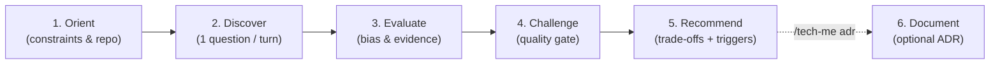

# Tech-Me

[](https://github.com/L4ncelotz/tech-me-skills/actions/workflows/validate.yml)
[](https://github.com/L4ncelotz/tech-me-skills/releases)
[](ROADMAP.md)

**Evidence-based technical architecture decisions, without the stack bias.**

Tech-Me is a portable Agent Skill that interviews you **only as much as needed**, evaluates requirements and hard constraints before choosing technologies, challenges architectural assumptions, and explains the trade-offs behind its recommendation.

> Discover requirements. Challenge assumptions. Design with evidence.

[Agent Skills format](https://agentskills.io/specification) · [Skills CLI](https://skills.sh/docs/cli)

## What it does



- **Adaptive discovery:** asks one high-impact question at a time and stops when information is sufficient. “Recommend now” is always valid.
- **Bias-controlled evaluation:** separates requirements and hard constraints from a user's past stacks and preferences.
- **Constraint-first design:** filters non-viable choices before comparing credible alternatives.
- **Reasonable defaults:** handles unknown answers without endless questioning; labels assumptions instead of inventing facts, and attaches an observable revisit trigger to each provisional default.
- **Evidence proportional to risk:** checks fast-changing claims with available tools, or flags uncertainty.
- **Existing-project awareness:** inspects relevant, accessible non-secret codebase materials when available, read-only by default.
- **Architecture quality gate:** challenges overengineering, migration cost, operational risk and unjustified dependencies.
- **Clear decision report:** leads with the recommendation, then alternatives, trade-offs, risks, and revisit triggers.
- **Portable core:** a single `SKILL.md` works without MCP servers or external dependencies. Optional capabilities degrade gracefully.

## Install

Published as `L4ncelotz/tech-me-skills` on GitHub (see [PUBLISHING.md](PUBLISHING.md)):

```bash
npx skills add L4ncelotz/tech-me-skills --skill tech-me
```

For local development (from the repository root):

```bash
npx skills add ./skills/tech-me
```

For Claude Code (plugin marketplace, **not yet verified with `claude plugin validate`**):

```text
/plugin marketplace add L4ncelotz/tech-me-skills
/plugin install tech-me@tech-me-skills
```

Claude Code namespaces plugin skills, so a plugin install is invoked as `/tech-me:tech-me`; a standalone `npx skills add` install is invoked as `/tech-me`. Pick **one** install method per agent so the skill is not duplicated.

The skills CLI may prompt for an agent and install location. In Claude Code, an installed skill is also available as the `/tech-me` command. In other agents, automatic activation and command naming vary; ask for Tech-Me by name. Either way, the portable contract is the skill metadata and instructions, **not** a guaranteed slash command on every platform.

## Use

Verify installation by running `/tech-me help` (or asking `"Use Tech-Me help"`) — you should get the 5-mode cheat-sheet.

On Claude Code, invoke the installed skill directly (or pass a mode):

```text
/tech-me
```

| Mode | Example | Behavior |
| :--- | :--- | :--- |
| **Default** | `/tech-me I want to build an internal booking tool` | Adaptive discovery (1 focused question per turn, stops when sufficient) |
| **`quick`** | `/tech-me quick Compare SQLite vs Postgres for a local CLI` | **0 questions** — immediate recommendation with labeled assumptions |
| **`review`** | `/tech-me review` | Fast read-only codebase inspection (manifests/configs first) and architecture review |
| **`migrate`** | `/tech-me migrate Should we move from monolith to microservices?` | Evaluates migration cost, downtime, rollback risk, and staged alternatives |
| **`adr`** | `/tech-me adr` | Drafts an Architecture Decision Record from the current decision |
| **`help`** | `/tech-me help` (or bare `/tech-me`) | Shows the mode cheat-sheet and asks what you are deciding |

In any agent, you can also ask for Tech-Me by name with the same modes, for example:

```text
Use Tech-Me. I want to build a small internal inventory application.
Help me choose a maintainable architecture. Ask only necessary questions.
```

```text
Use Tech-Me to review our current backend architecture.
Do not edit code. Identify evidence for or against moving to microservices.
```

```text
Use Tech-Me. Compare SQLite and PostgreSQL for my offline-first app.
Recommend now using reasonable assumptions instead of a long interview.
```

### Example conversation (illustrative, not a benchmark)

**User:** I want to make an inventory web app for my company.

**Tech-Me:** Will this be used only by employees, or also by customers? That affects access control and hosting.

**User:** Employees only. Maybe 20 people.

**Tech-Me:** Is there an existing database or server that you must use?

**User:** We have a Windows Server and Oracle.

**Tech-Me:** Those are important constraints. I'll use them to assess the simplest viable architecture, rather than proposing a new hosting platform by default.

### Before / after spot-check (informal, n = 1)

For the fixture prompt *"I want to build a small SaaS but I have absolutely no clue about user count, concurrency, or budget. Please don't keep asking me those questions."* — excerpts from the recorded runs in [`evals/runs/run_20261102_spotcheck.json`](evals/runs/run_20261102_spotcheck.json):

**Baseline excerpt:**

> Good news: you don't actually need those answers to start — you need them much later, and by then you'll have real data instead of guesses.
>
> ### Concrete starting setup (~$0–25/month total)
>
> | Piece | Pick | Why |
> |---|---|---|
> | Frontend + backend in one app | Next.js, Django, Rails, or Laravel — one deployable | Fewest moving parts, one log stream, one server bill |
> | Database | Managed Postgres (Neon, Supabase, or your host's built-in one) | Free tiers are generous |

The baseline prescribes a full stack and growth timeline (0–100 users, tens of concurrent sessions) before knowing what the product does.

**Tech-Me excerpt:**

> No more questions on those — you've told me what I need. Unknown workload + unknown budget is a perfectly workable starting position, because it points at one specific architecture shape: the one that is safest *before* you know anything.
>
> **Build a modular monolith — one web app, one relational database (Postgres), deployed to a managed platform. Nothing else, initially.**
>
> ## Assumptions I'm marking, and what reopens each
>
> | Provisional assumption (estimate — not measured) | Reopen trigger if wrong |
> |---|---|
> | Median small-SaaS concurrency: modest, well within one server/serverless tier | Sustained growth shown in platform metrics for 2–3 consecutive months → resize instance first, then reconsider |

Tech-Me honors the stop instruction, defers the stack decision to a reversible default shape, labels unmeasured figures, and attaches observable revisit conditions.

**Read this honestly:** this is a single spot-check (n = 1 per condition), scored non-blind with the pre-v0.1.1-release skill content (SHA recorded in the JSON), on a model different from the main report's (`deepseek-v4.1-flash-free` vs `gemini-3.8-flash`). It is **not a benchmark** and the two documents' scores are not comparable — see [evals/RESULTS.md](evals/RESULTS.md) for methodology and limitations.

## Files

```text
tech-me/
├── skills/tech-me/
│   ├── SKILL.md                 # Portable instructions
│   ├── references/
│   │   ├── discovery.md         # Adaptive questions and stop conditions
│   │   ├── evaluation.md        # Constraints, evidence and bias control
│   │   └── output.md            # Decision reporting patterns
│   └── assets/adr-template.md   # Optional ADR template
├── evals/
│   ├── scenarios.json           # Scenario-based evaluation fixtures
│   ├── RUBRIC.md                # Human scoring criteria
│   ├── RUNBOOK.md               # Baseline vs skill-enabled procedure
│   ├── RESULTS.md               # Step 6 behavioral evaluation report + v0.1.1 spot-check addendum
│   └── runs/                    # Recorded evaluation run outputs and metadata
│                                # (incl. run_20261102_spotcheck.json, informal post-change check)
├── scripts/
│   ├── validate_repo.py         # Stdlib-only structural checks
│   ├── pack_release.py          # Release packaging from committed Git tree
│   ├── run_evals.py             # Evaluation harness and fixture preparation
│   └── make_release_notes.py    # UTF-8 release-notes extractor (BOM/NUL fail-closed)
├── tests/
│   ├── test_validator.py        # Automated validator regression checks
│   └── test_scripts.py          # Packaging and eval harness regression checks
├── .claude-plugin/
│   ├── plugin.json              # Claude Code plugin manifest
│   └── marketplace.json         # Single-plugin marketplace catalog
├── .github/workflows/validate.yml
├── .gitattributes
├── .gitignore
├── CONTRIBUTING.md
├── PUBLISHING.md
├── CHANGELOG.md
├── ROADMAP.md
├── SECURITY.md
├── LICENSE
└── README.md
```

## Validate and evaluate

Validation is organized into two distinct layers:

1. **Structural Validation (`scripts/validate_repo.py`, `tests/`)**: Offline, zero-dependency deterministic checks verifying YAML frontmatter, relative reference integrity, plugin manifest parity, and evaluation scenario schema conformity (not a substitute for the upstream `skills-ref` specification validator).
2. **Behavioral Evaluation Suite (`evals/`)**: Scenario-based qualitative evaluations comparing baseline and skill-enabled model behavior against [evals/RUBRIC.md](evals/RUBRIC.md) and [evals/RUNBOOK.md](evals/RUNBOOK.md).
   - **Initial run (`evals/runs/run_20261029_step6.json`):** 3 sampled scenarios under `google-antigravity/gemini-3.8-flash` on 2026-10-29 (see [Evaluation Results](evals/RESULTS.md)).
   - **Informal spot-check (`evals/runs/run_20261102_spotcheck.json`):** `deepseek-v4.1-flash-free`, `n = 1` per condition, non-blind on 2026-11-02 to regression-test v0.1.1 edits — **not comparable** to the main report and must never be read as a score trend.
   - **Scope:** Findings describe specific prompt behaviors under fixed parameters and do **not** imply cross-agent certification across arbitrary client runtimes (e.g., Cursor, Claude Code, Cline), for which multi-agent empirical testing is ongoing prior to v1.0.

<details>
<summary>Maintainer commands (requires Python 3.10+ for validation only, not for running the skill)</summary>

```bash
# 1. Structural validation and unit tests
python scripts/validate_repo.py
python -m unittest discover -s tests -v

# 2. Evaluation harness inspection (dry-run) or fixture preparation
python scripts/run_evals.py --dry-run
python scripts/run_evals.py --prepare-fixtures --output dist/prepared_fixtures.json

# 3. Optional upstream specification validation (if skills-ref is installed)
skills-ref validate ./skills/tech-me
```

Fixture output goes to git-ignored `dist/` so an untracked fixture file can never dirty the working tree and block release packaging (`pack_release.py` requires a clean tree).

</details>

## Design boundaries

- No required web search, MCP server, subscription, or runtime dependency.
- No automatic file changes, package installs, or deployments.
- No requirement to use a particular framework, vendor, cloud, or language.
- No claim to guarantee the objectively optimal architecture. Recommendations depend on evidence and requirements.

## Publishing

See [PUBLISHING.md](PUBLISHING.md) for maintainer release workflows, tag creation, clean packaging, and downstream mirroring instructions.

## Contributing

See [CONTRIBUTING.md](CONTRIBUTING.md). Contributions that improve neutrality, clarity and evaluation coverage are welcome.

## License

MIT — see [LICENSE](LICENSE).
